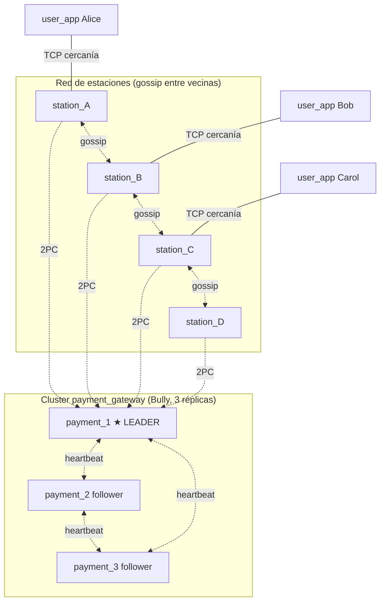
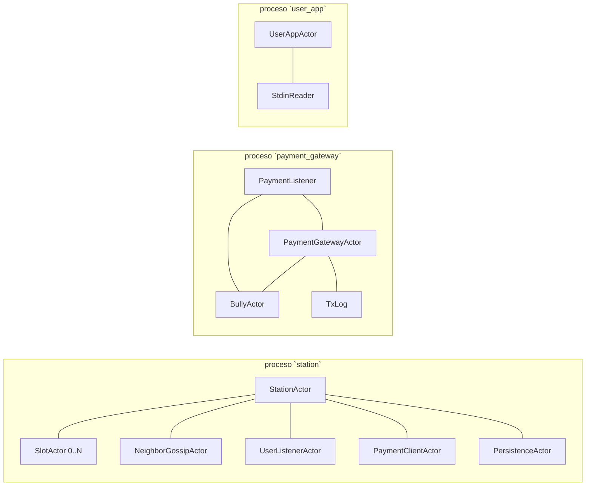

# Sistema distribuido de alquiler de bicicletas — TP Técnicas de Programación Concurrente

> **Primera entrega: Diseño.** Fecha máxima: 27 de Mayo de 2026.
> Cátedra de Técnicas de Programación Concurrente, FIUBA.

---

## Índice

1. [Descripción del problema](#1-descripción-del-problema)
2. [Resumen ejecutivo (TL;DR)](#2-resumen-ejecutivo-tldr)
3. [Decisiones de diseño](#3-decisiones-de-diseño)
4. [Arquitectura general](#4-arquitectura-general)
5. [Entidades en detalle](#5-entidades-en-detalle)
6. [Herramientas de concurrencia distribuida](#6-herramientas-de-concurrencia-distribuida)
7. [Casos de interés](#7-casos-de-interés)
8. [Análisis de correctness](#8-análisis-de-correctness)
9. [Mapeo a requerimientos del enunciado](#9-mapeo-a-requerimientos-del-enunciado)
10. [Cómo compilar y correr (Docker)](#10-cómo-compilar-y-correr-docker)
11. [Próximos pasos](#11-próximos-pasos)
12. [Glosario](#12-glosario)

---

## 1. Descripción del problema

Se debe desarrollar un **sistema distribuido en Rust** para el alquiler y devolución automatizada de bicicletas en una ciudad. Los componentes físicos son:

- **Estaciones distribuidas** por puntos de interés, cada una con entre **10 y 20 slots**. La cantidad total de estaciones es dinámica y se configura por archivo.
- **Bicicletas** con identificador único, reconocibles por las estaciones.
- **Usuarios** que llevan una app móvil que les permite consultar disponibilidad, alquilar, devolver y pagar.

Cada estación se sitúa en una **coordenada geográfica** (lat/lon) que se usa para definir vecindad y minimizar tráfico de red. El sistema debe seguir operando bajo desconexión parcial: tanto la app del usuario como una estación deben permitir alquiler y devolución estando offline, y reconciliar al recuperar conectividad.

---

## 2. Resumen ejecutivo (TL;DR)

Implementamos **3 binarios** que corren cada uno en su propio proceso, más **1 crate librería** compartido:

| Componente | Rol | Cantidad de instancias |
|---|---|---|
| `station` | Estación física, gestiona slots y dispara transacciones | Una por estación (dinámico) |
| `user_app` | App móvil del usuario | Una por usuario simulado |
| `payment_gateway` | Procesa cobros; replicado con líder electo | **3** en el cluster (decisión 🔒 ver sección 3) |
| `common` | Crate librería con tipos, mensajes y codec compartidos | — |

Todos los procesos están construidos con **actores Actix** (cero locks compartidos entre threads) y se comunican por **TCP** con frames JSON delimitados por `\n`.

Usamos **dos herramientas de concurrencia distribuida** exigidas por el enunciado:

- **Two-Phase Commit (2PC)** para coordinar atómicamente "asegurar la bici + cobrar al usuario".
- **Elección de líder Bully** para el cluster del payment_gateway, garantizando alta disponibilidad del cobro.

El sistema tolera caídas de estaciones y del líder de `payment_gateway`, y apps/estaciones pueden operar offline bufferando operaciones y reconciliando al reconectar usando `TxId` como mecanismo de **idempotencia**. En particiones de red severas, el comportamiento del cluster de payment queda acotado por una elección Bully simple, sin quorum.

---

## 3. Decisiones de diseño

Decisiones cerradas para esta entrega.

| # | Decisión | Valor elegido | Motivo |
|---|---|---|---|
| D1 | Lenguaje y compilador | **Rust stable**, `#![forbid(unsafe_code)]` en todos los crates | Obligatorio por enunciado |
| D2 | Framework de actores | **Actix 0.13** | Estándar de la cátedra; evita locks compartidos |
| D3 | Transporte | **TCP** para todo | Necesitamos entrega ordenada y confiable (2PC, cobros) |
| D4 | Herramientas distribuidas | **2PC + Bully** | 2PC encaja natural con "reservar + cobrar"; Bully da HA al cobro y se enseña en clase |
| D5 | Tolerancia a particiones | **Híbrida**: payment_gateway replicado, estaciones y app bufferan offline | Cumple el espíritu del enunciado sin desbordarnos en complejidad |
| D6 | Descubrimiento de vecinas | **Config estática** (`stations.json`) | Suficiente para la demo; evita complejidad de UDP broadcast |
| D7 | UDP | **No usar** | TCP cubre el caso; simplifica el modelo |
| D8 | Quién genera el `tx_id` | **La estación** | Conoce el estado del slot y resiste mejor apps offline |
| D9 | Persistencia local | **JSON append-only (WAL)** | Sin crates externos, debuggeable a mano |
| D10 | Réplicas de payment_gateway | **3 nodos** | Mínimo razonable para demostrar Bully bajo caídas |
| D11 | Topología de gossip | **Sólo entre vecinas cercanas** (umbral de distancia configurable) | Cumple "minimizar mensajes en la red" |
| D12 | Frame de red | **JSON delimitado por `\n`** sobre TCP | Sin crates externos, fácil de inspeccionar con `nc` |

> Algunas de estas decisiones son revisables si la cátedra sugiere correcciones en la presentación del diseño.

### 3.1 Correcciones y consideraciones (feedback de la cátedra)

Registro de los ajustes hechos a partir de la devolución sobre el diseño.

| # | Observación de la cátedra | Estado | Cómo se resolvió |
|---|---|---|---|
| C1 | **(Obligatoria)** Un usuario sin señal celular debe poder **alquilar y devolver** igual; lo que no puede es consultar disponibilidad. Es válido usar el último snapshot cacheado, asumir conectividad **local** con la estación de alquiler para enviarle el `card_token`, y que sea la **estación** la que cobra contra el gateway. | **Corregido** | Reescribimos [§7.3](#73-caída--usuario-sin-señal): el alquiler ya **no** se bloquea sin señal. Sólo `query` requiere red (cae al snapshot cacheado). Ajustamos [§7.7](#77-caída--estación-sin-conectividad-durante-alquiler), el [mapeo de requerimientos](#9-mapeo-a-requerimientos-del-enunciado) y el modelo del `UserAppActor` ([§5.7](#57-userappactor-proceso-user_app)). |
| C2 | **Bici no devuelta:** la solución es aceptable para el diseño; tener presentes las limitaciones y mitigaciones por si surge en la presentación final. | **Anotado** | [§7.8](#78-bicicleta-nunca-devuelta) ya documenta la limitación (depender del cliente) y las mitigaciones. La alternativa robusta —barrido de pre-autorizaciones vencidas en el líder del `payment_gateway`, sin depender del cliente— queda como la respuesta para la presentación. |

> **Nota sobre "señal".** En todo el informe distinguimos dos enlaces distintos: la **red general / datos celulares** (necesaria sólo para `query`) y la **conectividad local con la estación que el usuario tiene enfrente** (siempre disponible cuando el usuario está físicamente en la estación, y suficiente para entregar el `card_token`). "Usuario sin señal" se refiere a lo primero, nunca a lo segundo.

---

## 4. Arquitectura general

### 4.1 Diagrama de procesos



### 4.2 Threads internos de cada proceso

Como Actix monta un runtime Tokio multi-thread, los "threads" del enunciado se materializan como **actores independientes** que el runtime distribuye entre workers. Cada actor procesa mensajes secuencialmente, así que su estado interno no necesita locks.



### 4.3 Estructura del repositorio

```
TP_concu/
├── Cargo.toml              # workspace
├── Dockerfile              # imagen de desarrollo rust:latest + clippy/fmt/gdb
├── docker-compose.yml      # monta el repo como volumen rw
├── common/                 # crate librería (tipos y mensajes compartidos)
│   ├── Cargo.toml
│   └── src/
│       ├── codec.rs
│       ├── config.rs
│       ├── lib.rs
│       ├── messages.rs
│       └── types.rs
├── station/                # binario
│   ├── Cargo.toml
│   └── src/
│       ├── config.rs
│       ├── main.rs
│       ├── neighbor_gossip.rs
│       ├── payment_client.rs
│       ├── persistence.rs
│       ├── slot_actor.rs
│       ├── station_actor.rs
│       └── user_listener.rs
├── user_app/               # binario
│   ├── Cargo.toml
│   └── src/
│       ├── config.rs
│       ├── main.rs
│       └── user_app_actor.rs
├── payment_gateway/        # binario
│   ├── Cargo.toml
│   └── src/
│       ├── main.rs
│       ├── gateway_actor.rs
│       ├── bully.rs
│       ├── listener.rs
│       ├── config.rs
│       └── tx_log.rs
└── README.md               # este informe
```

Cada tipo de dato y cada actor en su propia unidad de compilación, como exige el enunciado.

---

## 5. Entidades en detalle

Para cada entidad describimos su finalidad, estado interno, mensajes (entrantes y salientes), protocolos y casos de interés.

### 5.1 StationActor

**Finalidad.** Es el actor raíz dentro del proceso `station`. Coordina todo lo que pasa en una estación física: mantiene un mapa de slots, recibe usuarios, hace gossip con vecinas y dispara las transacciones 2PC contra el payment_gateway.

**Estado interno (Rust).**

```rust
pub struct StationActor {
    pub config: StationConfig,
    pub location: GeoPoint,
    pub slots: HashMap<SlotId, Addr<SlotActor>>,
    pub neighbors: Vec<NeighborInfo>,              // sólo vecinas cercanas
    pub neighbor_snapshots: HashMap<StationId, StationSnapshot>,
    pub pending_ops: Vec<PendingOp>,               // buffer offline
    pub payment_leader: Option<SocketAddr>,
    pub is_online: bool,
    payment_client: Addr<PaymentClientActor>,
    persistence: Option<Addr<PersistenceActor>>,
    wal_path: Option<PathBuf>,
    pending_returns: HashMap<BikeId, PendingReturn>,
}
```

**Mensajes que recibe.**

| Mensaje | Payload | Reacción |
|---|---|---|
| `BikeDetected` | `{ slot_id, bike_id }` | Correlaciona la bici con un `UserNearby(Return)`, calcula el cargo y ejecuta la operación; si no hay conexión, la persiste en el WAL |
| `UserNearby` | `{ user_id, slot_id, card_token, intent, rental? }` | En `Rent`, ejecuta la reserva y el cobro; en `Return`, registra el contexto y espera `BikeDetected` |
| `GossipState` | `{ from_station, snapshot }` | Actualiza `neighbor_snapshots` |
| `StationQuery` | `{ user_location }` | Responde con el snapshot propio y los snapshots de gossip dentro de `query_radius_km`, ordenados por distancia Haversine |
| `PaymentLeaderChanged` | `{ new_leader_addr }` | Actualiza el líder de pagos usado por `PaymentClientActor` |
| `GoOffline` / `GoOnline` | control simulado | Cambia la conectividad de la estación; al volver online drena el WAL |

**Mensajes que envía.**

| Mensaje | Destino | Payload |
|---|---|---|
| `Prepare`/`Commit`/`Abort` | `PaymentClientActor` → líder del payment | `{ tx_id, ... }` |
| `ReserveBike`/`ReleaseBike`/`AbortReservation` | `SlotActor` | `{ tx_id }` |
| `GossipState` | Estaciones vecinas | `{ snapshot }` |
| `StationsNearby` | `user_app` | `{ stations: Vec<Snapshot> }` |

**Protocolos.** TCP en todas sus interacciones de red. JSON delimitado por `\n` como protocolo de aplicación.

**Casos de interés.**
- Caso feliz: ver [§7.1](#71-caso-feliz--alquiler) y [§7.2](#72-caso-feliz--devolución).
- Estación pierde conectividad: bufferea en `pending_ops` + WAL, retransmite al reconectar usando el mismo `tx_id` (idempotencia). Ver [§7.4](#74-caída--estación-sin-conectividad-durante-devolución).
- Estación crashea en medio de un 2PC: ver [§7.6](#76-caída--coordinador-estación-en-pleno-2pc).

---

### 5.2 SlotActor

**Finalidad.** Modela un slot físico de la estación. Hay entre 10 y 20 por estación. Cada `SlotActor` es single-threaded por definición de actor, lo que hace que las transiciones de estado del slot sean **atómicas sin locks**.

**Estado interno.**

```rust
pub enum SlotState {
    Empty,
    Occupied { bike_id: BikeId, since: SystemTime },
    Reserved { bike_id: BikeId, tx_id: TxId },     // en medio de 2PC
}

pub struct SlotActor {
    pub slot_id: SlotId,
    pub state: SlotState,
}
```

**Mensajes que recibe.**

| Mensaje | Payload | Reacción |
|---|---|---|
| `SimulateBikeArrival` | `{ bike_id }` | Si `state == Empty`, transiciona a `Occupied` y notifica `BikeDetected` al `StationActor` |
| `ReserveBike` | `{ tx_id }` | Si `state == Occupied`, transiciona a `Reserved { tx_id }` y vota `Yes`. Si no, vota `No` |
| `ReleaseBike` | `{ tx_id }` | Si `state == Reserved { tx_id }`, transiciona a `Empty` |
| `AbortReservation` | `{ tx_id }` | Vuelve `Reserved { tx_id }` → `Occupied` |

**Mensajes que envía.**

| Mensaje | Destino | Payload |
|---|---|---|
| `BikeDetected` | `StationActor` | `{ slot_id, bike_id }` |

**Protocolo.** Sólo paso de mensajes Actix dentro del proceso. No habla red directamente.

**Casos de interés.** Como las transiciones son secuenciales en un único actor, no puede haber doble reserva del mismo slot. El estado `Reserved { tx_id }` actúa como **lock semántico** del slot durante el 2PC.

---

### 5.3 NeighborGossipActor

**Finalidad.** Mantiene conocimiento parcial de las estaciones vecinas (criterio: cercanía geográfica), minimizando tráfico global. Empuja snapshots periódicos y recibe los de las vecinas.

**Estado interno.**

```rust
pub struct NeighborGossipActor {
    pub neighbors: Vec<NeighborInfo>,
    pub cached_states: HashMap<StationId, StationSnapshot>,
}
```

**Mensajes que recibe.**

| Mensaje | Payload | Reacción |
|---|---|---|
| `GossipState` (entrante) | `{ from_station, snapshot }` | Inserta/actualiza `cached_states` (LWW por `timestamp`) |
| `Tick` interno | — | Publica nuestro snapshot hacia las vecinas |

**Mensajes que envía.**

| Mensaje | Destino | Payload |
|---|---|---|
| `GossipState` (saliente) | Vecinas TCP | `{ snapshot }` |

**Protocolo.** Cada tick abre una conexión TCP corta a cada vecina, envía un `GossipState` JSON delimitado por `\n` y cierra el socket. No hay conexión persistente ni un canal de reconexión dedicado: el siguiente tick vuelve a intentar.

**Caso de interés.** Vecina caída: simplemente deja de llegar un snapshot más nuevo. El sistema conserva el último snapshot recibido y lo ordena por distancia en `StationQuery`; hoy no existe una marca explícita de "stale" ni un timeout que lo descarte.

---

### 5.4 UserListenerActor

**Finalidad.** Acepta conexiones TCP de las apps de usuario y de estaciones vecinas. Aísla todo el networking; el resto del sistema no conoce sockets.

**Estado interno.**

```rust
pub struct UserListenerActor {
    pub listening_port: u16,
    pub station_addr: Addr<StationActor>,
    pub gossip_addr: Addr<NeighborGossipActor>,
}
```

**Protocolo.** TCP. Por cada conexión lee líneas JSON como `InboundStationMessage`. Para `UserNearby` y `StationQuery` usa `station.send(...).await` y devuelve la respuesta por el socket. Para gossip, llegada simulada de bici, cambios de líder de pago y control `GoOffline`/`GoOnline`, reenvía con `do_send` porque no espera respuesta TCP.

---

### 5.5 PaymentClientActor

**Finalidad.** Es el cliente del cluster de payment_gateway desde la estación. Conoce al líder vigente, abre una conexión TCP persistente con él y mantiene en memoria el estado de las transacciones 2PC en curso.

**Estado interno.**

```rust
pub struct PaymentClientActor {
    pub current_leader: Option<NodeId>,
    pub leader_addr: Option<SocketAddr>,
    pub pending_txs: HashMap<TxId, TxInfo>,
    pub request_timeout: Duration,
    cmd_tx: Option<UnboundedSender<ConnCommand>>,
}
```

**Mensajes que envía.**

| Mensaje | Destino | Payload |
|---|---|---|
| `PaymentRequest::Prepare` | Líder payment_gateway | `{ tx_id, user_id, card_token, amount_cents }` |
| `PaymentRequest::Commit` / `PaymentRequest::Abort` | Líder payment_gateway | `{ tx_id }` |

**Caso de interés.** El actor mantiene una tarea `connection_manager` con una conexión TCP persistente al líder. Los handlers (`SendPrepare`, `SendCommit`, `SendAbort`) encolan pedidos por un canal interno y esperan la respuesta por `oneshot`. Si el líder no responde o cae la conexión, el cliente marca al líder como desconocido y falla rápido; la estación decide si persiste la fase pendiente en WAL para reintentar con el mismo `tx_id` cuando reciba un nuevo `PaymentLeaderChanged`.

---

### 5.6 PersistenceActor

**Finalidad.** Persiste un **Write-Ahead Log** append-only en JSON con todas las operaciones generadas localmente. Sirve para (1) recuperar tras un crash, (2) bufferear durante desconexión y (3) reconciliar con el payment cuando vuelve la red.

**Estado interno.**

```rust
pub struct PersistenceActor {
    pub log_path: PathBuf,
    pub buffered_ops: Vec<String>,
}
```

**Protocolo.** Sólo escribe a disco. No habla red.

---

### 5.7 UserAppActor (proceso `user_app`)

**Finalidad.** Modela la app móvil. Lee comandos por stdin, mantiene cache local de estaciones cercanas y **opera sin señal celular**: alquilar y devolver siempre funcionan (usan el enlace local con la estación que el usuario tiene enfrente); sólo `query` necesita la red general y, sin ella, cae al último snapshot cacheado.

**Estado interno.**

```rust
pub struct UserAppActor {
    pub config: UserAppConfig,
    pub location: GeoPoint,
    pub credit_card: CardToken,
    pub current_rental: Option<ActiveRental>,
    pub cached_stations: Vec<StationSnapshot>,       // se actualiza al consultar (con señal)
    pub signal_available: bool,                      // datos celulares / red general; NO el enlace local con la estación
    pub current_station_addr: SocketAddr,
}
```

**Comandos por stdin.**

| Comando | Requiere señal | Reacción |
|---|---|---|
| `query` | **Sí** (si no, usa el cache) | Con señal manda `StationQuery` a la estación más cercana; sin señal responde con el último snapshot cacheado (posiblemente viejo) |
| `rent <station_id> <slot_id>` | No | Usa el **enlace local** con la estación y manda `UserNearby(Rent)` con el `card_token`; la estación se encarga del cobro contra el gateway |
| `return <station_id> <slot_id>` | No | Manda `UserNearby(Return)` por el enlace local (o lo bufferea si está offline) |

**Mensajes que envía.**

| Mensaje | Destino | Payload |
|---|---|---|
| `StationQuery` | Estación cercana | `{ user_location }` |
| `UserNearby` | Estación | `{ user_id, slot_id, card_token, intent, rental? }` |

**Protocolo.** TCP punto a punto con la estación más próxima.

**Casos de interés.** Usuario sin señal: ver [§7.3](#73-caída--usuario-sin-señal). Bicicleta nunca devuelta: ver [§7.8](#78-bicicleta-nunca-devuelta).

---

### 5.8 PaymentGatewayActor (proceso `payment_gateway`)

**Finalidad.** Procesa cobros. Replicado en **3 nodos**. Sólo el líder atiende transacciones; los followers están listos para reemplazarlo si caen los heartbeats.

**Estado interno.**

```rust
pub enum TwoPCState {
    Prepared { tx: TxRecord, ts: SystemTime },
    Committed,
    Aborted,
}

pub struct PaymentGatewayActor {
    pub config: PaymentGatewayConfig,
    pub role: Role,                              // Leader | Follower | Candidate
    pub current_leader: Option<NodeId>,
    pub pending_2pc: HashMap<TxId, TwoPCState>,
    pub processed_tx: HashMap<TxId, TxOutcome>,  // idempotencia
    pub last_heartbeat: SystemTime,
    pub tx_log: TxLog,
}
```

**Mensajes que recibe (desde `listener.rs`, originados por `PaymentClientActor` en estaciones).**

| Mensaje | Reacción |
|---|---|
| `Prepare` | Si el `tx_id` ya está en `processed_tx`, responde el resultado anterior. Si no, valida la tarjeta, guarda `Prepared`, responde `Vote::Yes`/`No` |
| `Commit` | Marca `Committed`, ejecuta el cobro real, responde `TxOutcome::Committed` |
| `Abort` | Marca `Aborted`, libera la pre-autorización, responde `TxOutcome::Aborted` |

**Mensajes Bully (entre réplicas, ver [§5.9](#59-bullyactor)).**

**Protocolo.** El actor no abre sockets directamente. El módulo `payment_gateway/src/listener.rs` acepta TCP, parsea `PaymentRequest`, hace `gateway.send(...).await`, serializa `Vote` o `TxOutcome` y responde una línea JSON.

---

### 5.9 BullyActor

**Finalidad.** Implementa el algoritmo Bully de elección de líder. Vive dentro del proceso `payment_gateway`, como subactor del `PaymentGatewayActor`.

**Estado interno.**

```rust
pub struct BullyActor {
    pub node_id: NodeId,
    pub self_addr: SocketAddr,
    pub peers: Vec<(NodeId, SocketAddr)>,
    pub stations: Vec<SocketAddr>,
    pub role: Role,
    pub leader: Option<(NodeId, SocketAddr)>,
    pub last_heartbeat: SystemTime,
    waiting_for_coordinator: bool,
    got_ok_vote: bool,
    election_epoch: u64,
}
```

**Mensajes Bully (entre réplicas).**

| Mensaje | Payload | Reacción |
|---|---|---|
| `Heartbeat` | `{ from_node }` | Resetea timer en followers |
| `Election` | `{ from_node }` | Si nuestro `node_id > from_node`, respondemos `OkVote` e iniciamos nuestra propia elección |
| `OkVote` | `{ from_node }` | Sabemos que hay alguien con prioridad mayor, esperamos su `Coordinator` |
| `Coordinator` | `{ leader_node, leader_addr }` | Aceptamos al nuevo líder, pasamos a `Follower` |

**Protocolo.** TCP entre nodos del cluster. Cada `BullyMessage` viaja como JSON `\n`-delimitado hacia el listener del otro `payment_gateway`.

**Timers internos.** Al arrancar, cada `BullyActor` registra dos timers Actix:

- `HeartbeatTick`: se dispara en todos los nodos, pero sólo el líder lo usa para enviar `BullyMessage::Heartbeat` por TCP a sus peers.
- `HeartbeatCheck`: se dispara en todos los nodos, pero sólo los followers revisan `now - last_heartbeat`; si supera el timeout, llaman a `start_election()`.

Cuando un nodo se convierte en líder, manda `Coordinator` a los otros gateways, actualiza su `PaymentGatewayActor` local con `LeadershipUpdate` y avisa a las estaciones con `PaymentLeaderChanged`.

---

### 5.10 Payment listener (`payment_gateway/src/listener.rs`)

**Finalidad.** Es el adaptador TCP del proceso `payment_gateway`. En el mismo puerto recibe dos familias de mensajes:

| JSON recibido | Destino interno | Respuesta TCP |
|---|---|---|
| `PaymentRequest::{Prepare, Commit, Abort}` | `PaymentGatewayActor` vía `send(...).await` | Sí: `Vote` o `TxOutcome` |
| `BullyMessage::{Election, OkVote, Coordinator, Heartbeat}` | `BullyActor` vía `do_send(...)` | No; entrega el mensaje y cierra esa conexión |

Esto separa el networking del estado: el listener sólo parsea, despacha y serializa respuestas; la lógica de pagos vive en `PaymentGatewayActor` y la elección de líder vive en `BullyActor`.

---

## 6. Herramientas de concurrencia distribuida

### 6.1 Two-Phase Commit

**Por qué.** Al alquilar o devolver una bici hay dos efectos que tienen que ser atómicos en conjunto:

- (a) cambio de estado del slot (`Empty` ↔ `Occupied`)
- (b) cobro o pre-autorización en la tarjeta del usuario

Si confirmamos (a) y falla (b), regalamos el viaje. Si confirmamos (b) y falla (a), cobramos sin servicio. **Caso de libro para 2PC.**

**Roles.**

- **Coordinador:** `StationActor` (vía su `PaymentClientActor`).
- **Participantes:** el `SlotActor` local y el líder vigente del cluster `payment_gateway`.

**Flujo.**

```
1. Coord → SlotActor:     ReserveBike(tx_id, bike_id?) → vote local
2. Coord → PaymentLeader: Prepare(tx_id, amount)       → vote: YES si tarjeta válida
3. Si ambos YES:
       Coord → PaymentLeader: Commit(tx_id)      → cobro efectivo
       Coord → SlotActor:     ReleaseBike(tx_id) → confirma Rent o Return
   Si alguno NO:
       Coord → SlotActor:     AbortReservation(tx_id)
       Coord → PaymentLeader: Abort(tx_id)
   Si la estación no llega al payment:
       Coord → PersistenceActor: AppendOp(Prepare/Commit/Abort pendiente)
       Coord → SlotActor:       ReleaseBike(tx_id) en modo optimista
```

**Timeouts.** El `PaymentGatewayActor` aborta transacciones `Prepared` que quedan sin decisión durante `PREPARE_TIMEOUT_SECS`. El `PaymentClientActor` también limita cada espera de respuesta TCP; si el líder no responde, la estación conserva la fase pendiente en WAL cuando corresponde.

**Idempotencia.** El `tx_id` es generado por la estación (UUID-like). Cualquier `Prepare`/`Commit`/`Abort` con el mismo `tx_id` produce el mismo resultado, así que los retries son seguros.

### 6.2 Elección de líder Bully

**Por qué.** Necesitamos que el cobro siga funcionando aunque caiga el nodo principal de pago. Bully es simple de explicar, se enseña en clase y se implementa en pocas líneas.

**Algoritmo.**

1. Cada réplica del payment tiene un `node_id` único.
2. Si un follower no recibe heartbeat del líder en `HEARTBEAT_TIMEOUT`, inicia una elección.
3. Manda `Election` a todos los nodos con `node_id` mayor que el propio.
4. Si alguno responde `OkVote`, espera un `Coordinator`; si vence el timeout, vuelve a iniciar elección.
5. Si nadie de mayor prioridad responde, se autoproclama líder.
6. El nuevo líder manda `Coordinator` a los otros gateways y `PaymentLeaderChanged` a las estaciones configuradas.

**Garantías.** Si la red no se particiona, eventualmente hay un único líder (el de mayor `node_id` vivo).

---

## 7. Casos de interés

### 7.1 Caso feliz — alquiler

```
1. Alice abre la app y manda `query`. Recibe lista de estaciones cercanas con cantidad de bicis.
2. Alice camina hasta station_B, slot 3 (ocupado con bike_X).
3. App → Station: UserNearby(Rent, slot=3)
4. Station inicia 2PC:
     ReserveBike(tx_id) al SlotActor       → YES
     Prepare(tx_id, amount=PRE_AUTH) al líder → YES
5. Station envía ReleaseBike + Commit a ambos.
6. SlotActor pasa a Empty. La bici queda liberada físicamente.
7. App recibe BikeReleased y arranca el contador de tiempo.
```

### 7.2 Caso feliz — devolución

```
1. Bob llega a station_D y la app envía UserNearby(Return) con el contexto de la rental.
2. StationActor guarda ese contexto hasta que el sensor detecte la bicicleta.
3. SlotActor → StationActor: BikeDetected(bike_Y, slot=7).
4. StationActor correlaciona ambos mensajes, calcula el monto y llama a execute_operation.
5. execute_operation reserva el slot, ejecuta Prepare/Commit y confirma la operación física.
6. Si todo OK, el slot pasa a Occupied y Bob recibe ReturnConfirmed.
```

### 7.3 Caída — usuario sin señal

> **Corrección sobre el diseño original (feedback de la cátedra).** El requisito es obligatorio: *«si un usuario no tiene señal celular debe poder igualmente alquilar y devolver bicicletas»*. La versión anterior de este informe bloqueaba el alquiler sin señal; eso era incorrecto y quedó corregido acá.

**Qué significa "sin señal".** No hay **datos celulares / acceso a la red general**, pero se **asume conectividad local con la estación física** que el usuario tiene enfrente (enlace directo app↔estación, p. ej. el punto de acceso de la propia estación). El `card_token` viaja por ese enlace local, no por la red celular. Bajo esa premisa las tres operaciones se comportan así:

- **Consultar disponibilidad (`query`) → es lo único que requiere señal.** Necesita alcanzar la red para refrescar snapshots de estaciones que no tengo enfrente. Sin señal el usuario **opera con el último snapshot cacheado** (que puede estar viejo): no es un bloqueo, es información posiblemente desactualizada.
- **Alquilar → funciona sin señal.** El usuario está físicamente en la estación, así que el handshake **local** app↔estación entrega `user_id` + `card_token`. La app elige estación/slot a partir del snapshot cacheado. **La estación —no la app— maneja el cobro** con el `payment_gateway` (2PC). Si la estación tampoco tiene conexión al gateway, se cae en el flujo offline de la estación ([§7.7](#77-caída--estación-sin-conectividad-durante-alquiler)): WAL + idempotencia por `tx_id`.
- **Devolver → funciona sin señal.** La app usa el enlace local para mandar `UserNearby(Return)` con el contexto de la rental; la estación lo deja pendiente hasta que el sensor del slot emite `BikeDetected`. Recién al correlacionar ambos eventos arranca el 2PC o el fallback al WAL.

**Flujo de alquiler sin señal (Alice):**

```
1. Alice no tiene datos celulares; abre la app y ve el ÚLTIMO snapshot cacheado.
2. Camina a station_B (que el cache marca con bicis) y elige el slot 3.
3. App ↔ station_B por enlace LOCAL: UserNearby(Rent, slot=3, card_token).
4. station_B arranca el 2PC (ReserveBike al slot + Prepare/Commit al payment leader):
     - Si station_B tiene red al gateway → cobro en línea (caso feliz §7.1).
     - Si station_B NO tiene red al gateway → bufferea en el WAL y reconcilia luego (§7.7).
5. station_B libera la bici. Alice se va aunque su celular nunca recupere señal.
```

**Flujo de la devolución sin señal (Carol):**

```
1. Carol quiere devolver su bici en station_C pero su celular no tiene datos.
2. La app usa el enlace local con station_C y manda `UserNearby(Return, rental=...)`.
3. StationActor guarda ese contexto en `pending_returns`.
4. Cuando el sensor informa `BikeDetected`, la estación correlaciona la bici con la devolución pendiente.
5. La estación calcula el monto y ejecuta 2PC contra el líder de pagos; si no llega al gateway, persiste la operación en WAL.
```

> **Por qué se puede alquilar sin señal.** Autenticar al usuario y entregar el `card_token` **no necesita red celular**: se hace por el enlace local con la estación, que es quien después cobra contra el gateway. Lo único que depende de la red general es *enterarse* de la disponibilidad de estaciones lejanas (`query`), y para eso alcanza el snapshot cacheado. El caso en que es la *estación* —y no el usuario— la que está sin conexión durante un alquiler se trata aparte en [§7.7](#77-caída--estación-sin-conectividad-durante-alquiler).

### 7.4 Caída — estación sin conectividad durante devolución

```
1. El usuario pidió `return` por el enlace local y la estación guardó el contexto en `pending_returns`.
2. El sensor detecta la bici, pero station_C no puede hablar con el payment leader.
3. station_C reserva el slot, persiste un `PendingOp::Prepare` en el WAL con un `tx_id` único y confirma localmente la devolución.
4. Más tarde, recupera conectividad con `GoOnline`.
5. `PersistenceActor` entrega los `pending_ops` a `StationActor`.
6. Station retransmite `Prepare(tx_id, ...)` con el MISMO `tx_id` y, si responde `Yes`, manda `Commit(tx_id)`.
7. Cuando la operación se resuelve, la estación compacta el WAL y elimina la entrada drenada.
```

### 7.5 Caída — líder del payment_gateway

```
1. El líder vigente deja de mandar `BullyMessage::Heartbeat` por TCP.
2. Los followers siguen ejecutando `HeartbeatCheck`; al superar `HEARTBEAT_TIMEOUT`, llaman a `start_election()`.
3. Cada candidato manda `Election` sólo a peers con `node_id` mayor.
4. El nodo vivo con mayor `node_id` no recibe `OkVote` de nadie superior, se vuelve líder y manda `Coordinator` a los demás gateways.
5. El nuevo líder actualiza su `PaymentGatewayActor` local con `LeadershipUpdate`.
6. El nuevo líder manda `PaymentLeaderChanged` a las estaciones configuradas para que sus `PaymentClientActor` reconecten al nuevo líder.
```

En el deploy actual, si cae `gateway3` queda líder `gateway2`; si cae `gateway1` mientras `gateway2` y `gateway3` siguen vivos, el líder sigue siendo `gateway3`.

```text
Gateway caído durante una request:
- si el proceso completo cayó, la estación no conecta o pierde la respuesta TCP;
- si la estación ya tenía una fase de pago pendiente, la persiste en WAL y la reintenta con el mismo `tx_id` cuando conoce al nuevo líder.
```

### 7.6 Caída — coordinador (estación) en pleno 2PC

```
1. station_B alcanza a mandar `Prepare(tx_id)` al líder y cae antes de mandar `Commit` o `Abort`.
2. El líder deja la transacción en `Prepared`.
3. Si no llega una decisión antes de `PREPARE_TIMEOUT_SECS`, el `PaymentGatewayActor` aborta unilateralmente y registra `TxOutcome::Aborted` en el `TxLog`.
4. Cualquier reintento posterior con el mismo `tx_id` devuelve el resultado ya registrado: `Prepare` responde `No("already aborted")` y `Commit`/`Abort` devuelven `Aborted`.
5. En el camino online actual, la estación no persiste el `Prepare` antes de enviarlo; por eso la garantía principal ante esta caída está del lado del líder y su timeout de `Prepared`.
```

### 7.7 Caída — estación sin conectividad durante alquiler

Caso complementario a [§7.4](#74-caída--estación-sin-conectividad-durante-devolución), que cubre la *devolución*. Acá el usuario está **presente** y el handshake **local** app↔estación funciona (tenga o no señal celular: ese enlace es local), pero es la **estación** la que no puede hablar con el payment leader. Como un alquiler es un cargo nuevo podríamos rechazarlo; en cambio elegimos una política **optimista** para no bloquear al usuario, asumiendo el riesgo de forma explícita.

```
1. El usuario hace el handshake con station_C: UserNearby(Rent). La estación SÍ tiene los datos del alquiler.
2. station_C no logra contactar al payment leader para el Prepare.
3. station_C reserva y libera la bici localmente (SlotActor: Occupied → Reserved → Empty)
   y persiste la operación en el WAL con un tx_id único.
4. station_C entrega la bici al usuario (no lo hace esperar).
5. Al recuperar conectividad, PersistenceActor entrega los pending_ops a StationActor.
6. station_C retransmite Prepare(tx_id, ...) con el MISMO tx_id (idempotencia).
7. El payment leader procesa la pre-autorización. Si la tarjeta es inválida, el cargo se
   concilia como deuda del usuario (no se puede "des-entregar" la bici).
```

> **Trade-off consciente.** Para el alquiler con estación offline elegimos **disponibilidad** (entregar la bici) sobre consistencia estricta del cobro. Es el mismo patrón offline-first de §7.4 (WAL + idempotencia por `tx_id`), pero acá aceptamos el riesgo de una tarjeta que resulte inválida porque bloquear a un usuario presente sería peor para la experiencia. En **ambos** casos el alquiler sigue adelante: en §7.3 el que no tiene señal celular es el *usuario* (y el enlace local con la estación basta para entregar el `card_token`); acá la que no llega al gateway es la *estación* (y resuelve con WAL + idempotencia). Nunca bloqueamos un alquiler por falta de conectividad.

### 7.8 Bicicleta nunca devuelta

**Estado actual de la implementación.** La app guarda la rental activa en `current_rental` cuando recibe `BikeReleased`, y la limpia sólo cuando recibe `ReturnConfirmed`. Si el usuario nunca devuelve la bici, no hay hoy un timer ni un barrido que cierre automáticamente esa rental o cobre una penalización.

**Qué se observa en el flujo actual.**

```
1. Alice alquila bike_X. La app guarda ActiveRental { bike_id, origin_station, started_at_ms }.
2. Si nunca ejecuta `return`, ninguna estación recibe `UserNearby(Return)`.
3. Sin `UserNearby(Return)` tampoco aparece una entrada en `pending_returns`.
4. Sin `BikeDetected` correlacionado con una devolución pendiente, la estación no dispara cobro de devolución ni penalización.
```

**Limitación conocida.** Este caso queda como mejora de diseño. La alternativa más robusta sería que el líder de `payment_gateway` o un servicio de reconciliación mantenga un registro de alquileres abiertos y haga un barrido de vencidos, sin depender de que la app del usuario coopere. Otra opción más simple, pero más débil, sería agregar un timer en `UserAppActor` que avise vencimientos cuando la app esté viva.

---

## 8. Análisis de correctness

### 8.1 ¿Por qué no hay deadlocks?

- **Cero locks compartidos entre threads.** Todo el estado vive dentro de actores Actix; cada actor procesa mensajes secuencialmente. No hay esperas circulares sobre mutexes porque no usamos mutexes.
- **Sin esperas síncronas anidadas.** Cuando un actor necesita una respuesta de otro, usa `send().await`, que no bloquea el ejecutor Tokio subyacente: el thread sigue atendiendo a otros actores.
- **Timeouts en todas las esperas distribuidas.** Las fases `Prepared` del 2PC y los pasos del Bully tienen timeouts; ningún actor queda colgado indefinidamente.

### 8.2 ¿Por qué no hay race conditions?

- **Transiciones de estado del slot atómicas** dentro del `SlotActor` (single-threaded por construcción).
- **Idempotencia por `tx_id`:** dos `Prepare` con el mismo `tx_id` producen el mismo resultado (lectura en `processed_tx`).
- **El estado `Reserved { tx_id }` evita doble alquiler:** mientras un slot está reservado, ningún otro `tx_id` puede tocarlo.

### 8.3 ¿Por qué no hay doble cobro?

El `PaymentGatewayActor` mantiene `processed_tx: HashMap<TxId, TxOutcome>` persistido en el `TxLog`. Cualquier `Prepare`/`Commit` con un `tx_id` ya conocido devuelve el resultado anterior sin re-ejecutar el cobro real.

### 8.4 ¿Qué pasa si la red se particiona?

- Estaciones del lado A siguen aceptando devoluciones (bufferean en WAL).
- Estaciones del lado B también.
- El cluster de `payment_gateway` usa Bully simple: si una partición aísla a un nodo sin peers de mayor `node_id` visibles, ese nodo puede autoproclamarse líder en su lado de la red.
- No hay quorum ni consenso distribuido: el README de diseño original era más fuerte que la implementación actual en este punto.
- **Trade-off actual:** las estaciones siguen privilegiando disponibilidad local con WAL + reintentos, pero la consistencia global del liderazgo de pagos no está garantizada bajo particiones arbitrarias.

### 8.5 Limitaciones actuales del failover de payment

- El failover sí recupera el **liderazgo**: cuando cae el líder, otro nodo vivo puede asumir y anunciarse a las estaciones con `PaymentLeaderChanged`.
- El failover **no replica** el estado `pending_2pc` entre gateways. Las transacciones `Prepared` viven en memoria del líder actual.
- El `TxLog` persiste sólo outcomes finales (`Committed`/`Aborted`), no snapshots completos de `Prepared`.
- En consecuencia, si cae el líder durante una transacción en curso, la recuperación fuerte depende de los reintentos de la estación con el mismo `tx_id` y de los timeouts locales; no existe hoy una reanudación automática coordinada desde el nuevo líder.

---

## 9. Mapeo a requerimientos del enunciado

| Requerimiento | Cómo lo cumplimos |
|---|---|
| 10-20 slots por estación | `slots: HashMap<SlotId, Addr<SlotActor>>` configurable |
| Identificador único por bici | `BikeId` (`u64`, único en el sistema) |
| App muestra estaciones cercanas | `StationQuery` → `StationsNearby` con snapshot propio y snapshots de gossip filtrados por radio geográfico |
| Usuario sin señal puede alquilar **y** devolver | Enlace local app↔estación entrega el `card_token`; la estación cobra contra el gateway; `query` cae al snapshot cacheado ([§7.3](#73-caída--usuario-sin-señal)) |
| Operación offline (usuario y estación) | Buffer local (WAL) + idempotencia por `tx_id` ([§7.4](#74-caída--estación-sin-conectividad-durante-devolución), [§7.7](#77-caída--estación-sin-conectividad-durante-alquiler)) |
| Minimizar mensajes en la red | Gossip sólo entre vecinas geográficas, no broadcast global |
| Rust, biblioteca estándar | ✅ (sólo dependencia externa: Actix, autorizado) |
| Modelo de actores | Actix en los 3 binarios |
| Procesos independientes | 3 binarios separados (`station`, `user_app`, `payment_gateway`) + 1 crate compartido (`common`) |
| ≥ 2 herramientas de concurrencia distribuida | **2PC + Bully** |
| Sin GUIs/TUIs | CLI por stdin/stdout y archivos JSON |
| Sin `unsafe`, sin warnings, `cargo fmt` | `#![forbid(unsafe_code)]` en cada crate; CI pendiente |
| `cargo doc` | Hay documentación parcial; el código actual usa `#![allow(missing_docs)]` en lugar de `#![deny(missing_docs)]` |
| Tests automatizados | Ya hay tests unitarios en módulos clave (`bully`, `gateway_actor`, `neighbor_gossip`, `payment_client`, `persistence`, `tx_log`); falta ampliar cobertura integrada/end-to-end |
| Una unidad de compilación por tipo | Cada actor y cada tipo en su archivo |

---

## 10. Cómo compilar y correr (Docker)

El repositorio incluye un entorno de desarrollo Docker (`rust:latest` + `clippy` + `rustfmt` + `gdb` + `cargo-watch`) que monta este directorio como volumen `rw`. Toda la compilación pasa por el container; el host no necesita Rust instalado.

### Levantar el entorno

```bash
# 1) (Sólo la primera vez) copiar .env.example y poner tu UID/GID del host
cp .env.example .env
echo "USER_UID=$(id -u)"  >> .env
echo "USER_GID=$(id -g)"  >> .env

# 2) Construir y arrancar
docker compose up -d --build  # construye la imagen y levanta el container
docker compose exec dev bash  # abre una shell dentro
```

> `.env` está gitignored. El UID/GID se mapean al usuario `dev` del container, así los archivos que cargo genera (`Cargo.lock`, `target/`) quedan con los permisos del usuario host y no de root.

### Comandos esenciales (dentro o vía `docker exec`)

```bash
# Compilar todo el workspace
docker exec tp-concu-dev cargo build --workspace

# Linters estrictos (lo que pide el enunciado)
docker exec tp-concu-dev cargo clippy --workspace --all-targets -- -D warnings
docker exec tp-concu-dev cargo fmt --all -- --check

# Tests (a medida que los vayamos agregando)
docker exec tp-concu-dev cargo test --workspace

# Documentación (cargo doc)
docker exec tp-concu-dev cargo doc --workspace --no-deps --open
```

### Correr los binarios (placeholder; se irán completando)

```bash
docker exec tp-concu-dev cargo run -p station
docker exec tp-concu-dev cargo run -p user_app
docker exec tp-concu-dev cargo run -p payment_gateway
```

Para hacer pruebas multi-nodo se levantan **varios containers** o se ejecutan varios procesos con distintos puertos dentro del mismo container; ambos enfoques son equivalentes porque cada binario sólo necesita un puerto TCP y un identificador propio.

### Apagar el entorno

```bash
docker compose down          # detiene el container
docker compose down -v       # detiene y borra volúmenes (cache de cargo)
```

---

## 11. Próximos pasos

### Antes del 27/05 (primera entrega)

- [x] Esqueleto de código compilable (validar que el diseño es implementable, lo recomienda el enunciado).
- [x] `clippy -D warnings` y `cargo fmt --check` pasan limpio en el esqueleto.
- [x] README convertido en informe completo.
- [ ] Mostrarle el diseño al ayudante para feedback temprano.

### Hacia la segunda entrega (16/06)

1. **Caso feliz extremo-a-extremo** funcionando: alquilar + devolver + cobrar.
2. **2PC con timeouts** y abortos unilaterales.
3. **Bully** con simulación de caída del líder (`kill -9` a un proceso).
4. **WAL** de estación y de payment para idempotencia.
5. **Gossip de vecinas** con LWW por timestamp.
6. **Tests de concurrencia** que ejerciten cada caso de §7 de manera reproducible.

### Repartición tentativa del trabajo

| Persona | Responsabilidad principal | Toca |
|---|---|---|
| 1 | `station` (slots, listener, persistencia) | `station_actor.rs`, `slot_actor.rs`, `persistence.rs`, `user_listener.rs` |
| 2 | `payment_gateway` (Bully + 2PC servidor) | `gateway_actor.rs`, `bully.rs`, `tx_log.rs` |
| 3 | `user_app` + `common` (mensajes, tipos compartidos, gossip) | `user_app/`, `common/`, `neighbor_gossip.rs` |

El 2PC y la integración cruzan los tres binarios, así que se trabaja entre los tres.

### Riesgos identificados

- **Bully implementado mal** se cuelga: hay que testearlo con simulación de caídas (`kill -9`).
- **Reconexión TCP** requiere backoff exponencial en `NeighborGossipActor` y `PaymentClientActor`.
- **Tiempo:** unas 3 semanas para implementación. Hay que tener el caso feliz funcionando antes de meternos con las caídas exóticas.

---

## 12. Glosario

- **2PC (Two-Phase Commit):** protocolo distribuido que garantiza que una transacción se confirma en todos los participantes o en ninguno.
- **Bully:** algoritmo de elección de líder donde gana el nodo con mayor identificador.
- **Idempotencia:** propiedad por la cual ejecutar una operación N veces produce el mismo efecto que ejecutarla una sola vez.
- **Gossip:** patrón donde cada nodo comparte su estado con un subconjunto de pares, propagando información sin broadcast global.
- **WAL (Write-Ahead Log):** archivo append-only donde se persisten operaciones antes de aplicarlas, para poder recuperar tras una caída.
- **LWW (Last-Writer-Wins):** estrategia de reconciliación de conflictos basada en timestamp: gana la versión más reciente.
- **CP / CAP:** en el teorema CAP, una opción consciente por consistencia y tolerancia a particiones, sacrificando disponibilidad parcial.
